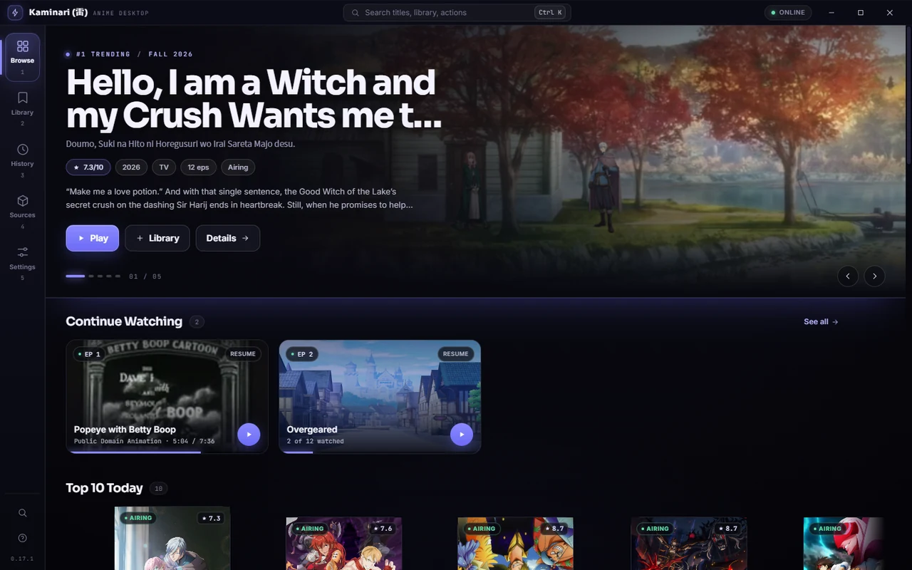
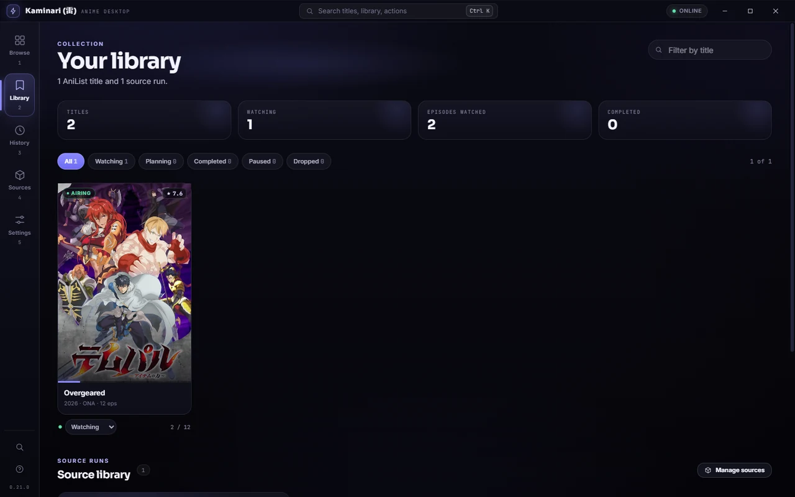
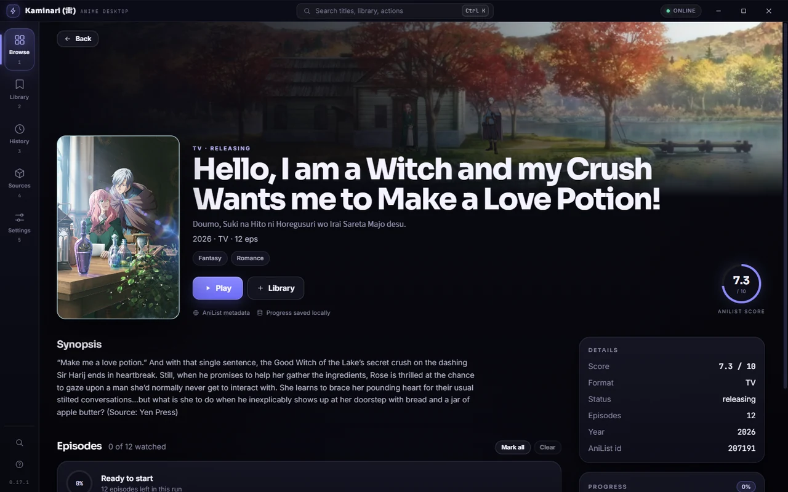
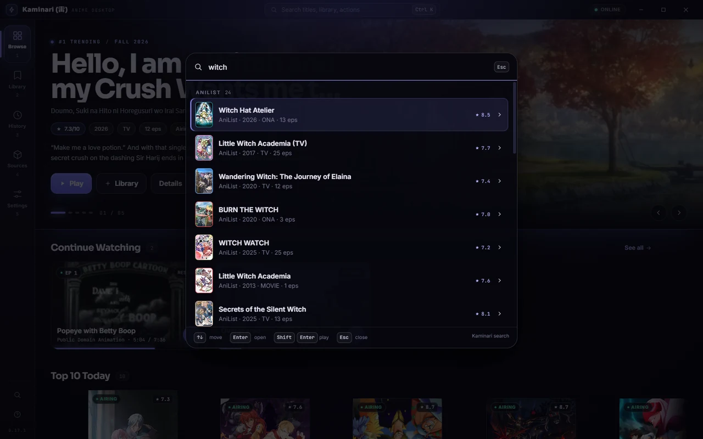
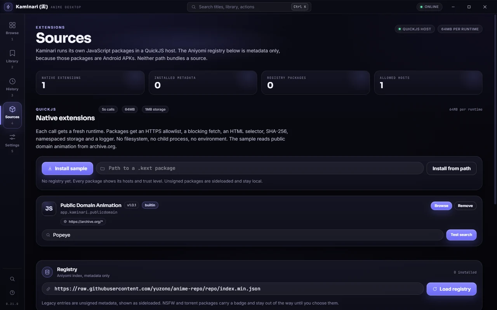

# Kaminari

Aniyomi, but for PC.

A desktop anime app for Windows first, with care in every pixel. Fast startup. Keyboard first. A library you own in one SQLite file. AniList for data. Extensions you choose for more. No content ships in the box.

> Ships no content, no source list. It talks to AniList for data, and to extensions you choose to install for more. That is the whole idea.

    

| Library | Search | Player | Extensions |
|---|---|---|---|
| Watching and planning with progress and history | Ctrl K palette, live plus cached offline | In-app MP4 and HLS, optional embedded libmpv, external mpv fallback, J L K keys, diagnostics with D | Sandboxed QuickJS, local .kext, explicit host allowlists |

Screenshots are captured from the current Windows build in the Storm theme and live in `assets/screenshots/`. Every PR that changes UI updates one screenshot.

| Browse | Library |
|---|---|
|  |  |
| **Detail** | **Player** |
|  |  |
| **Search palette** | **Sources** |
|  |  |

## What it is

- **Core:** Tauri 2 plus Rust for shell, networking, database, extension host, player bridge
- **Interface:** Svelte 5 with Runes plus TypeScript plus Tailwind CSS 4
- **Data:** AniList GraphQL for titles, posters, scores, tracking
- **Player:** in-app WebView playback for MP4 and HLS, with external mpv as the fallback for formats the WebView cannot play
- **Extensions:** sandboxed JS modules through QuickJS, local `.kext` packages, Aniyomi registry metadata

## Why this stack

Tauri keeps the installer small and startup fast. Rust keeps the heavy parts honest. Network, storage, and trust live there. Svelte keeps the interface light and easy to shape by hand. The in-app player covers MP4 and HLS; mpv handles the formats a web player will not. QuickJS lets authors use plain JavaScript without writing Rust.

If you already know React, the Rust side does not care. The contract stays the same.

## Status

Working today: cinematic browse with five AniList rails, Top 10 Today, Ctrl K palette, detail pages, a local AniList library, watched episode tracking, Continue Watching, an Aniyomi registry reader that stores source metadata, a native JavaScript extension host with a source browser, details, episodes and stream resolve, an in-app player for MP4 and HLS, a loopback stream proxy for headers, cookies, HLS media and master playlists, a source library with resumable playback progress, source Continue Watching and merged history, System, Dark and Light themes, a Windows tray menu with show and quit, and an in-app license list generated from the build.

Embedded libmpv is bundled behind the default-off `kaminari.libmpv` flag. Set `localStorage["kaminari.libmpv"]="true"` or add `?libmpv=1` to the app URL to opt in. The default player stays the WebView player with external mpv fallback. Public distribution waits for counsel review of `docs/LEGAL-REVIEW-DRAFT.md`; the dev spike passes z-order, HEVC and fallback on Windows. A 2026-11-08 review confirmed Suwayomi is manga-only and cannot run Aniyomi/yuzono anime extensions, so native `.kext` stays the bundled source model. The app does not download APKs or run package code from the Aniyomi registry.

Windows is the first target. macOS and Linux come later.

## Run it

```bash
pnpm install
pnpm tauri dev
```

Builds are produced locally with `pnpm tauri build`; the build verifies the pinned libmpv DLLs with `pnpm check:libmpv` before packaging. GitHub Releases will follow the first public build. No telemetry, no ads, no account needed to browse.

## Versioning

The root `VERSION` file is the only version source. `pnpm build` and `pnpm tauri` run `scripts/sync-version.mjs` first, which writes `package.json` and `src-tauri/Cargo.toml`. Tauri reads the package version, Vite injects `__APP_VERSION__` into the frontend, and Rust reads `CARGO_PKG_VERSION`. `src-tauri/build.rs` refuses a build where `VERSION` and `Cargo.toml` disagree.

## Licenses

Settings, and the footer, open a generated list of every Rust crate, npm package, font and built-in sample in this build. The rows carry versions, license identifiers, sources and full license texts where the installed package includes one. Native libmpv artifacts are bundled and listed under Native libraries with their hashes, source URLs and the source offer. Run `pnpm licenses:build` after dependency changes; it regenerates `public/licenses.json` from `Cargo.lock` and the installed node_modules.

## Principles

1. **Do not trust a measurement you have not taken.** Every choice gets measured before it ships, from bundle size to search latency.
2. **If the screen cannot see it, it cannot trust it.** Request counts, cache use, and source health stay visible where they matter.
3. **The library is yours.** One SQLite file you can copy, back up, and move. Uninstall leaves it alone.
4. **Small pages, honest copy.** Short sentences. Real errors. No fake success states.

## Docs

- `docs/ARCHITECTURE.md`: how the pieces fit
- `docs/DESIGN-SPEC.md`: tokens, components, motion
- `docs/EXTENSION-API.md`: public contract for extension authors, plus Aniyomi registry mapping
- `docs/PLAN-JS-EXTENSIONS.md`: native host decisions, API, milestones and tests
- `docs/LEGAL-REVIEW-DRAFT.md`: draft counsel packet for the bundled libmpv artifacts
- `docs/ENGINEERING-NOTES.md`: measured numbers and decisions that reversed
- `docs/ROADMAP.md`: what comes next and what done means
- `docs/TERMS.md`: terms of service for distributed builds
- `docs/PRIVACY.md`: local-first privacy policy
- `VERSION`: the single version source
- `public/licenses.json`: generated license list used by Settings

## Legal

Kaminari ships no content, no source list, and no APKs. It is a general-purpose player and extension host. You are responsible for the extensions you install and the content you access. Read the [Terms of Service](docs/TERMS.md) and the [Privacy Policy](docs/PRIVACY.md).

This project is not legal advice. If you distribute builds publicly, have a qualified lawyer review the terms for your jurisdiction.

## Contributing

See `CONTRIBUTING.md` for setup and review rules.

## License

MIT. See `LICENSE`. Unofficial and not affiliated with AniList. The name Kaminari means thunder in Japanese.
